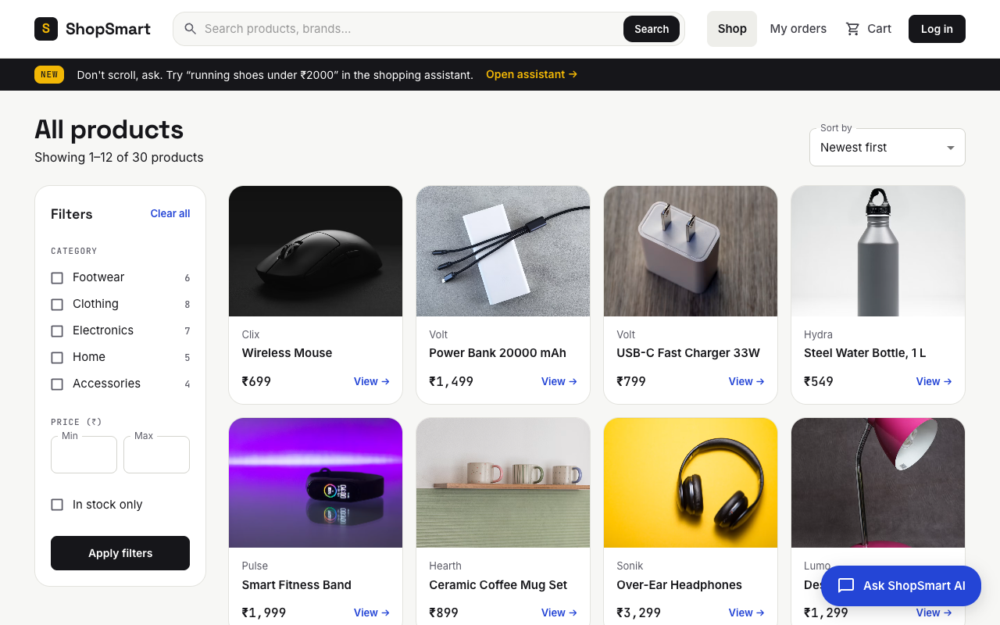
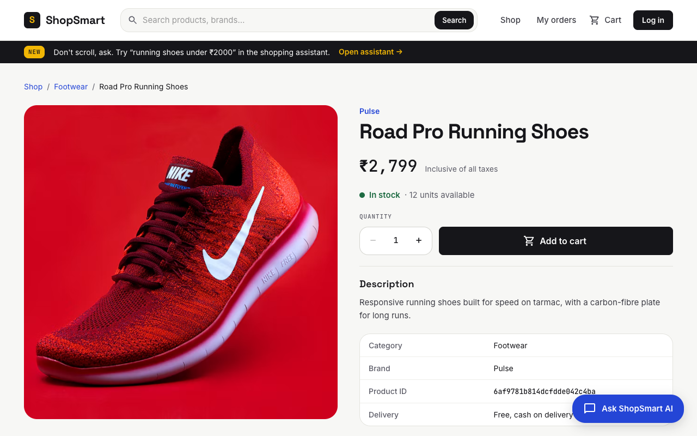
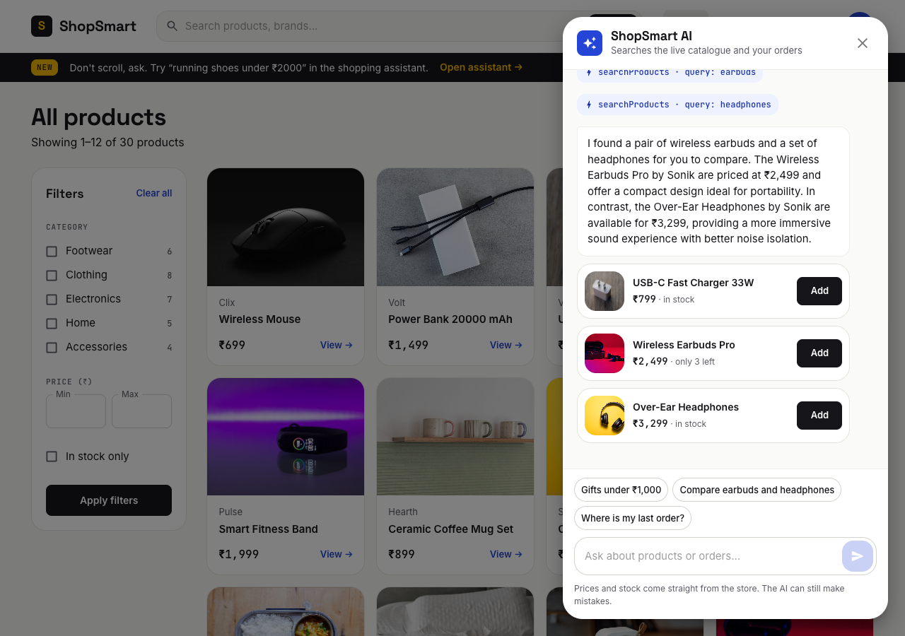
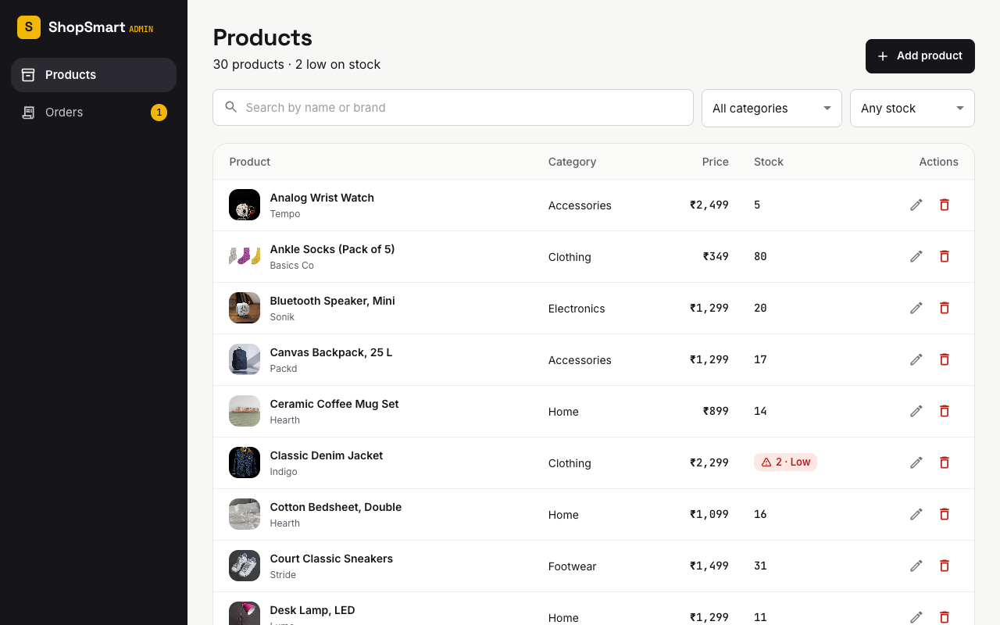
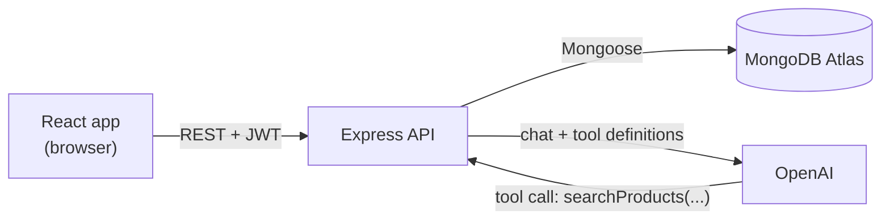

# ShopSmart

An e-commerce store built with the MERN stack, with an AI shopping assistant that answers from the live catalogue using OpenAI function calling.

**Live:** [abhishek-shopsmart.vercel.app](https://abhishek-shopsmart.vercel.app)



## Features

**Shop**
- Search, multi-category and price filters, sorting and pagination. Filters live in the URL, so refresh, the back button and shared links keep them.
- Product pages with photos, stock status and related products. Sample product photos are from [Unsplash](https://unsplash.com) and load from its CDN.
- Cart stored in the browser (works for guests) that re-checks prices and stock against the API when opened.
- Cash-on-delivery checkout, order tracking, and cancellation until an order ships.

**AI shopping assistant**
- Ask in plain words: "running shoes under 2000", "gifts under ₹1,000", "where is my last order?".
- The model never answers from memory. It chooses a tool, the API runs the real MongoDB query, and the reply is written from those results.
- The chat shows which tools were called, with product cards (add to cart from the chat) and order cards.

**Admin panel**
- Products: search, category and stock filters, add / edit / delete.
- Orders: counts per status, search by customer, city or order number, and status changes limited to allowed steps.

| Product page | AI assistant |
|---|---|
|  |  |



## Tech stack

| Layer | Tools |
|---|---|
| Frontend | React 19, Vite, Material UI, React Router, Axios |
| Backend | Node.js, Express 5, Mongoose, JSON Web Tokens, bcrypt |
| Database | MongoDB Atlas |
| AI | OpenAI `gpt-4o-mini` with function calling |
| Hosting | Vercel: static frontend and the API as a serverless function, deployed on every push to `main` |

## Architecture



### How the assistant works

1. The browser sends the conversation to `POST /api/chat`.
2. The API sends it to OpenAI together with three tool definitions (name, description, JSON Schema).
3. Instead of answering, the model can return a tool call, for example `searchProducts({ query: "running shoes", maxPrice: 2000 })`.
4. The API runs the matching function against MongoDB and sends the result back to the model.
5. The model writes a short reply from those results. The API returns the reply plus the products, orders and tool calls for the UI.

| Tool | What it does |
|---|---|
| `searchProducts` | Keyword, category and price search over in-stock products, cheapest first, at most 5 |
| `getProductDetails` | Full details of one product |
| `getMyOrderStatus` | The current user's recent orders, or one order by number |

The model only ever sees what these functions return. `getMyOrderStatus` always filters by the user from the JWT, so a prompt cannot make it read another customer's orders. The API also drops any `system` or `tool` messages sent by the client, caps the history and message length, and limits each reply to three tool rounds.

## Design notes

- **Stock can't be oversold.** Placing an order decrements stock with one conditional update per product (`stock >= qty` and `$inc` in the same operation), so two customers cannot both buy the last unit. If a later line fails, stock already reserved for that order is returned.
- **Prices come from the database.** The client sends only product ids and quantities; the server looks up prices and computes the total.
- **Orders keep a snapshot** of each item's name and price, so editing or deleting a product never changes past orders.
- **Status changes are guarded.** Orders move Placed → Shipped → Delivered, or Placed → Cancelled. Each change only applies if the order is still in the expected status, so a double click can't return stock twice.
- **One error format.** A central error handler turns validation, duplicate-key, invalid-id and token errors into `{ message }` with the right status code.

## API

All routes are under `/api`. 🔒 = needs a logged-in user, 🛡️ = admin only.

| Method | Route | |
|---|---|---|
| POST | `/auth/register` | Create an account, returns a token |
| POST | `/auth/login` | Log in, returns a token |
| GET | `/auth/me` | 🔒 Current user |
| GET | `/products` | List: `search`, `category` (comma-separated), `minPrice`, `maxPrice`, `inStock`, `stock=low\|out`, `sort`, `page`, `limit` |
| GET | `/products/categories` | Product count per category |
| GET | `/products/:id` | One product |
| POST / PUT / DELETE | `/products`, `/products/:id` | 🛡️ Create, update, delete |
| POST | `/orders` | 🔒 Place an order: `{ items: [{ product, qty }], shippingAddress }` |
| GET | `/orders/my` | 🔒 My orders |
| GET | `/orders/:id` | 🔒 One order (owner or admin) |
| PUT | `/orders/:id/cancel` | 🔒 Cancel while still Placed |
| GET | `/orders` | 🛡️ All orders: `status`, `search`, `page`, `limit`; includes counts per status |
| PUT | `/orders/:id/status` | 🛡️ Move to the next status |
| POST | `/chat` | 🔒 Ask the assistant: `{ messages: [{ role, content }] }` |

## Running locally

You need Node.js 20 or newer, a MongoDB database (a free Atlas cluster works), and an OpenAI API key for the assistant.

```bash
git clone https://github.com/Abhishekmishrz/shopsmart.git
cd shopsmart
```

**API**

```bash
cd backend
npm install
cp .env.example .env    # then fill in the values below
npm run seed            # 30 sample products + the admin and demo customer from .env
npm run dev             # http://localhost:5050
```

| Variable | Purpose |
|---|---|
| `MONGO_URI` | MongoDB connection string |
| `JWT_SECRET` | Long random string used to sign tokens |
| `OPENAI_API_KEY` | Needed only for the assistant |
| `CLIENT_URL` | Frontend URL allowed by CORS, e.g. `http://localhost:5173` |
| `ADMIN_*`, `CUSTOMER_*` | Accounts created by `npm run seed` |

Port 5050 is used because macOS reserves 5000 for AirPlay.

**Frontend** (in a second terminal)

```bash
cd frontend
npm install
cp .env.example .env    # VITE_API_URL=http://localhost:5050/api
npm run dev             # http://localhost:5173
```

Log in with the admin email and password from `backend/.env` to open the admin panel at `/admin`.

## Project structure

```
backend/
  config/db.js            MongoDB connection, reused between requests
  models/                 User, Product, Order
  controllers/            auth, product, order, chat
  services/aiTools.js     tool definitions and the functions the assistant can call
  middleware/             JWT auth, admin check, central error handler
  routes/                 one router per resource
  seed/                   sample products (with photo links) and seed script
frontend/
  src/api/axios.js        API client: adds the token, normalises errors
  src/context/            AuthContext, CartContext
  src/components/         layout, navbar, chat widget, shared UI
  src/pages/              shop, product, cart, checkout, orders, admin
  src/theme.js            Material UI theme (colours, type, component defaults)
```
